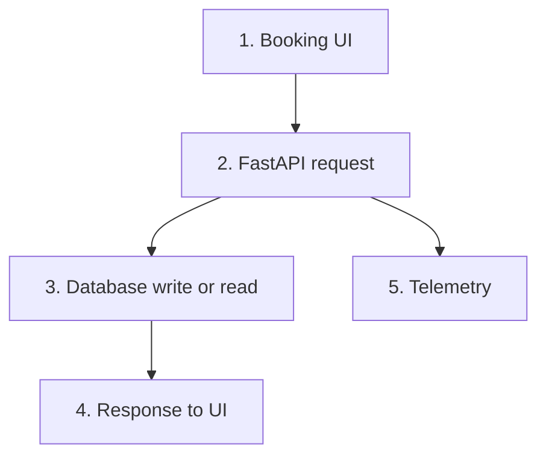

<div align="center">

# Barber Shop Booking

**Full-stack online booking product**

Booking flows for a single barber shop — clean API, modern frontend, and production-minded packaging.

[](https://www.python.org/)
[](https://react.dev/)
[](https://fastapi.tiangolo.com/)
[](https://mounir-gmamsi.netlify.app/)

</div>

---

## Overview

Barber Shop Booking is a full-stack application for online appointments. It separates backend API concerns from the React UI and includes Docker-based local delivery, authentication-related backend components, and observability hooks.

---

## What the product delivers

| Capability | Description |
|------------|-------------|
| Booking flows | Create and manage appointments for a single shop |
| API layer | Structured REST API with validated models |
| Frontend UX | React SPA for customer / shop interaction |
| Persistence | Relational storage with migrations |
| Local ops | Docker Compose for end-to-end startup |
| Quality | Tests and observability instrumentation |

---

## Technology stack

### Backend


### Frontend


### Platform


| Layer | Technologies |
|-------|----------------|
| API | FastAPI, Uvicorn, Pydantic, SQLAlchemy, Alembic, PostgreSQL |
| UI | React, TypeScript, Vite |
| Security | python-jose, passlib / bcrypt |
| Ops | Docker Compose, Nginx, OpenTelemetry, Prometheus client |

---

## Solution flow

| Step | Stage | Technologies |
|:----:|-------|--------------|
| 1 | User opens booking UI | React, Vite |
| 2 | API validates request | FastAPI, Pydantic |
| 3 | Persist booking data | SQLAlchemy, PostgreSQL |
| 4 | Return confirmation to UI | REST JSON |
| 5 | Observe system health | OpenTelemetry / metrics |



---

## Repository structure

| Path | Purpose |
|------|---------|
| `backend/` | FastAPI application, migrations, tests |
| `frontend/` | React + Vite client |
| `docker-compose.yml` | Local multi-service stack |
| `docs/` | Project documentation |
| `observability/` | Observability configuration |

---

## Run locally

```bash
copy .env.example .env
docker compose up --build
```

See `Makefile` and `docs/` for additional development commands.

---

## Author

**Mounir Gmamsi**  
[Portfolio](https://mounir-gmamsi.netlify.app/) · [GitHub](https://github.com/Mr-Gms-33) · [LinkedIn](https://www.linkedin.com/in/mounir-gmamsi-1595951b3)
