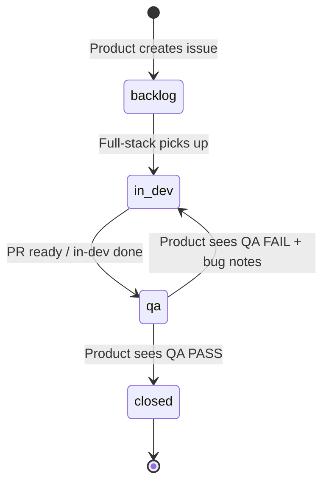

# Loop engineering (Product → Full-stack → QA)

Public tracker: https://github.com/Mr-Gms-33/barber-shop-booking/issues

Spec source: [PROJECT_HANDOFF.md §8](PROJECT_HANDOFF.md).

## Roles (hard rules)

| Role | May do | Must not do |
|------|--------|-------------|
| **Product / spec** | Create & groom issues; link PRs; **close** issues when QA passed; on **FAIL**, write bug notes and send back to Full-stack | Implement production code; mark QA pass/fail |
| **Full-stack** | Implement feature; open PR referencing issue; move issue to **in-dev** | Run automated tests as proof of done; **close** issues; declare QA pass/fail |
| **QA** | Run `make test` / manual checks; comment **`QA: PASS`** or **`QA: FAIL`** with evidence | **Close** or reopen issues; fix product code (file bugs only) |
| **Platform / SRE** | Same loop for non-functional issues (Docker, deploy, observability) | Skip Product close step |

## Issue states (labels)

| Label | Meaning |
|-------|---------|
| `status:backlog` | Groomed, not started |
| `status:in-dev` | Full-stack working (PR open) |
| `status:qa` | Implementation merged or ready for QA review |
| `status:blocked` | Waiting on Product/spec decision |

## One cycle



1. **Product** creates issue with testable acceptance criteria (from §8).
2. **Full-stack** implements, links PR (`Fixes #N` only when Product will drive close after QA).
3. **Full-stack** sets label `status:qa` when ready for verification (does not self-test for sign-off).
4. **QA** runs tests and scenario checks; comments exactly one verdict:
   - `QA: PASS` — evidence: commands run, results, screenshots if UI.
   - `QA: FAIL` — steps to reproduce, expected vs actual.
5. **Product** reads QA comment:
   - **PASS** → close issue, optional summary comment.
   - **FAIL** → comment bug summary for Full-stack, label `status:in-dev`, **keep issue open**.

## Grooming checklist (Product)

- Title: verb + outcome (testable).
- Body: single primary acceptance criterion + steps to verify.
- Labels: `agent:*`, `status:backlog`, area label if useful.
- Link to handoff section.

## Commands (QA)

```bash
make test
docker compose up --build   # when Docker available
```
